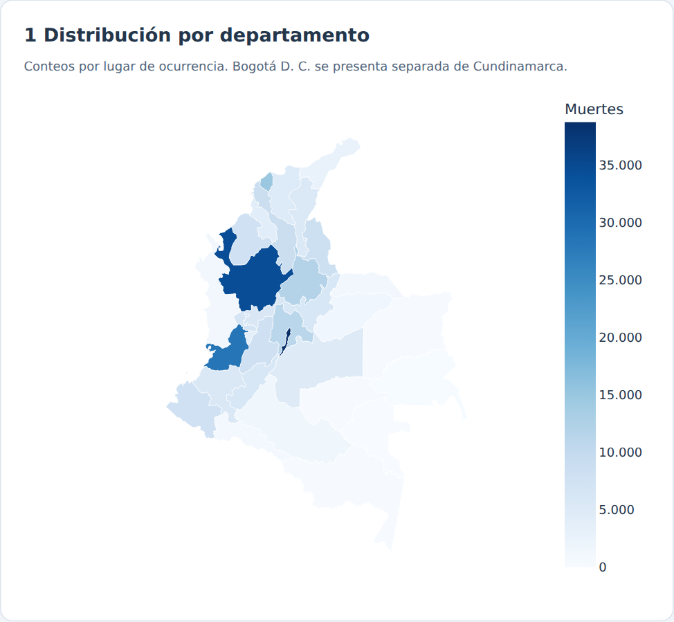
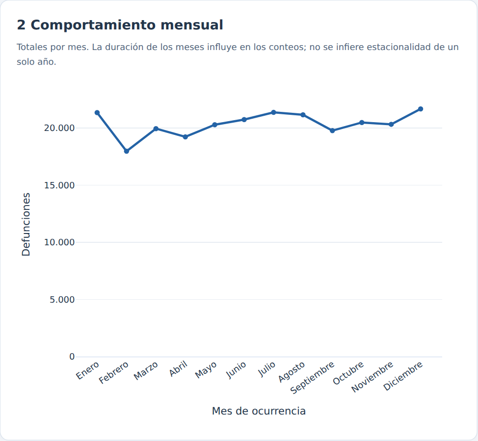
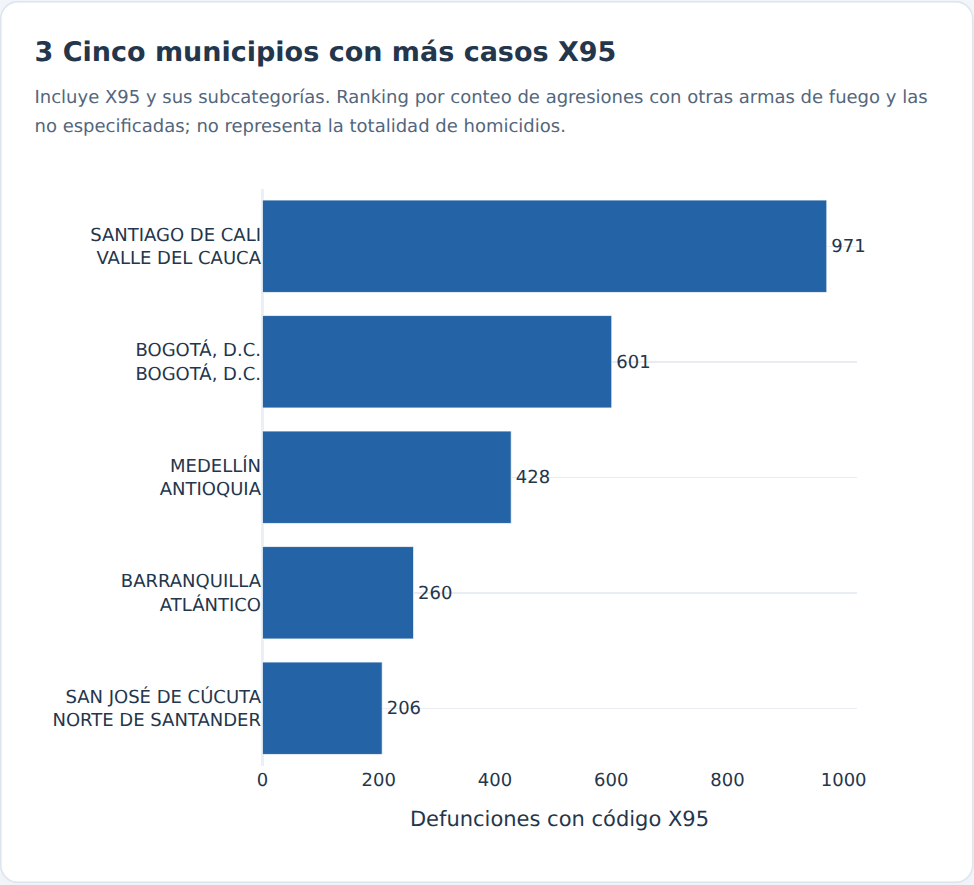
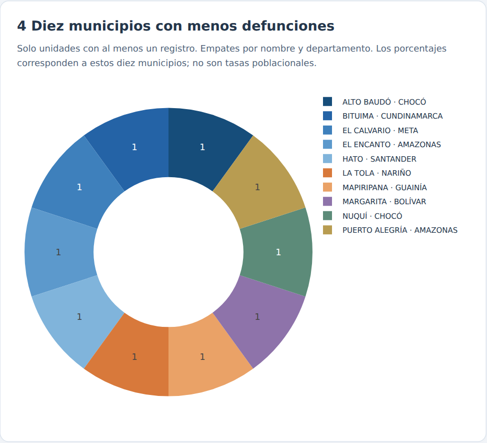
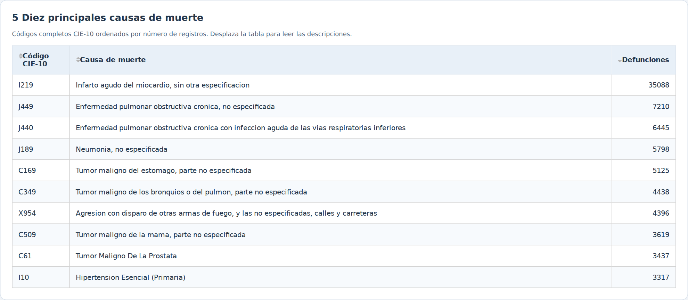
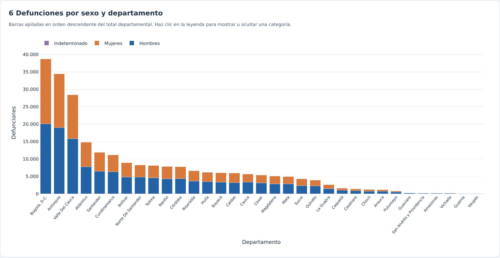
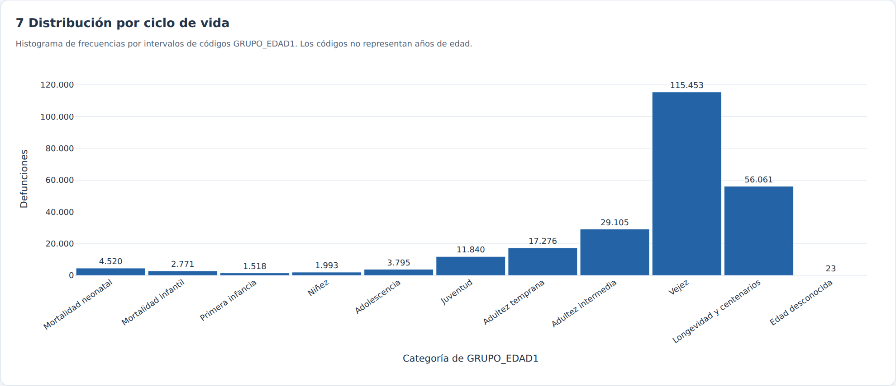

# Mortalidad en Colombia 2019

## Introducción del proyecto

Aplicación de análisis descriptivo en Python, Dash, Plotly y Pandas para explorar 244.355 defunciones no fetales de Colombia durante 2019. Integra siete visualizaciones y filtros por departamento, mes, sexo y ciclo de vida. Cada cambio recalcula los seis gráficos, la tabla y los indicadores.

El análisis describe conteos de defunciones por ocurrencia; no estima riesgo ni tasas por habitante. La base no contiene población. El ranking X95 cubre agresiones con otras armas de fuego y las no especificadas; no mide todos los homicidios.

## Objetivo

Analizar la distribución territorial, mensual y demográfica de la mortalidad no fetal registrada en 2019 mediante visualizaciones interactivas reproducibles.

## Estructura del proyecto

| Archivo o carpeta | Función |
| --- | --- |
| `estadistica.py` | Aplicación Dash, gráficos, filtros y exportación WSGI `server` |
| `analisis.py` | Validación, clasificación de edades y agregaciones |
| `preparar_datos.py` | Consolidación reproducible de los tres Excel originales |
| `data/originales/` | Descripción de los insumos para reconstruir la base |
| `data/registros/` | Registros de análisis particionados en CSV |
| `data/catalogos/` | Nombres territoriales y descripciones CIE-10 |
| `data/colombia.geo.json` | Polígonos de los 32 departamentos y Bogotá D. C. |
| `data/manifiesto.json` y `data/FUENTES.md` | Huella del CSV, controles y procedencia |
| `assets/estilos.css` | Diseño adaptable a escritorio y móvil |
| `assets/world_110m.json` | Recurso cartográfico local de Plotly |
| `requirements.txt` | Versiones de las dependencias de ejecución |
| `.python-version` | Versión de Python para Render |
| `render.yaml` y `Procfile` | Configuración de despliegue |
| `tests/test_proyecto.py` | Pruebas de integridad, filtros y callbacks HTTP |
| `verificar_interfaz.py` | Prueba real en navegador y generación de capturas |
| `docs/` | Capturas, resultados exportados y evidencia de verificación |
| `INICIAR_WINDOWS.bat` | Instalación y arranque local en Windows |

## Requisitos y software

Python 3.12; Dash 3.2.0, Plotly 6.3.0, Pandas 2.2.3, Openpyxl 3.1.5 y Gunicorn 23.0.0. Las versiones de las dependencias directas están fijadas en `requirements.txt`. La validación se ejecutó con Python 3.12.14. Gunicorn se utiliza en Linux/Render; el arranque local con Python también funciona en Windows.

## Instalación

Descarga este proyecto y abre una terminal en la carpeta que contiene `estadistica.py`. Para clonar el repositorio:

```bash
git clone https://github.com/josealonso2209/mortalidad-colombia-2019.git
cd mortalidad-colombia-2019
```

El repositorio contiene la aplicación, los datos, la documentación y las pruebas de esta versión.

En Windows:

```powershell
py -3.12 -m venv .venv
.venv\Scripts\Activate.ps1
python -m pip install -r requirements.txt
python estadistica.py
```

Si PowerShell bloquea la activación, ejecuta directamente `.venv\Scripts\python.exe -m pip install -r requirements.txt` y después `.venv\Scripts\python.exe estadistica.py`. También puedes hacer doble clic en `INICIAR_WINDOWS.bat`.

En Linux o macOS:

```bash
python3.12 -m venv .venv
source .venv/bin/activate
python -m pip install -r requirements.txt
python estadistica.py
```

Abre http://127.0.0.1:8050. El puerto se puede cambiar con `PORT`; `DASH_DEBUG=1` activa la depuración solo para desarrollo. En GitHub, la base de ejecución se distribuye en `data/registros/`, con cinco variables por defunción y catálogos separados para los nombres territoriales y CIE-10. La aplicación combina las particiones automáticamente. También admite el consolidado completo `data/mortalidad_2019.csv.gz` o su versión CSV, con prioridad sobre las particiones. La base se busca respecto a la carpeta del programa, independientemente del directorio de ejecución. `DATA_FILE` permite indicar otra base con el mismo esquema.

## Uso

Combina los cuatro selectores de la cabecera. Una lista vacía incluye todas las categorías. «Restablecer filtros» recupera la vista nacional. Los títulos indican el contenido de cada visualización y el resumen superior indica el alcance de la selección.

Al pasar el cursor se muestran valores exactos. La barra de herramientas de Plotly permite ampliar y descargar los gráficos. En las barras apiladas, hacer clic en la leyenda oculta o muestra categorías. La tabla permite ordenar los registros. Una combinación sin registros produce un aviso y gráficos vacíos.

## Visualizaciones y explicación de resultados

Todas las capturas se obtuvieron de la aplicación ejecutándose localmente con la base consolidada. Las interpretaciones siguientes corresponden a la vista nacional sin filtros.

### 1 Mapa departamental



Bogotá D. C. registra 38.760 defunciones, Antioquia 34.473 y Valle del Cauca 28.443. En conjunto suman 101.676, el 41,61 % de la base. Se conserva Bogotá como unidad separada. La escala representa conteos y no tasas. Un mayor conteo no prueba mayor riesgo individual.

### 2 Serie mensual



Diciembre tiene el mayor conteo, 21.678 registros, y febrero el menor, 17.974. Febrero tiene menos días; estos totales no son promedios diarios. Un solo año no permite demostrar estacionalidad ni atribuir las diferencias a una causa concreta. Si se filtran meses, los meses excluidos aparecen como huecos y no como ceros observados.

### 3 Cinco municipios con más defunciones X95



Se filtra el prefijo X95 de `COD_MUERTE`, incluidas sus subcategorías. Hay 9.273 registros nacionales. Cali tiene 971; Bogotá, 601; Medellín, 428; Barranquilla, 260; y San José de Cúcuta, 206. Se agrupa por código DANE completo para no mezclar municipios homónimos. El orden no equivale a una clasificación general de criminalidad.

### 4 Diez municipios con menos registros



Trece unidades territoriales tienen una defunción. Se muestran diez mediante desempate por nombre, departamento y código: Alto Baudó, Bituima, El Calvario, El Encanto, Hato, La Tola, Mapiripana, Margarita, Nuquí y Puerto Alegría. Cada sector equivale al 10 % del subconjunto mostrado. No se incluyen unidades ausentes de la base como si tuvieran cero muertes. «Menor índice» se interpreta operacionalmente como menor conteo positivo; calcular tasas exige población municipal.

### 5 Principales causas



I219, infarto agudo del miocardio sin otra especificación, reúne 35.088 registros, el 14,36 % del total. Le siguen J449 (7.210), J440 (6.445), J189 (5.798), C169 (5.125), C349 (4.438), X954 (4.396), C509 (3.619), C61 (3.437) e I10 (3.317). Se conservan los códigos completos: agrupar por tres caracteres produciría otro ranking.

### 6 Sexo y departamento



Hay 134.573 registros de hombres (55,07 %), 109.689 de mujeres (44,89 %) y 93 de sexo indeterminado (0,04 %). El conteo masculino supera al femenino en las 33 unidades. Las barras describen números de defunciones; no permiten comparar tasas específicas sin población por sexo y departamento.

### 7 Histograma por ciclo de vida



La categoría de códigos 20–24, vejez de 60 a 84 años, reúne 115.453 casos (47,25 %). Los códigos 25–28 agrupan 56.061 (22,94 %). Juntas representan el 70,19 %. Hay 23 registros con edad desconocida. Se conserva el orden de los once intervalos de clasificación; los códigos no son edades en años. El histograma muestra frecuencias preagrupadas con barras contiguas para no transferir todos los microdatos al navegador.

## Pruebas

```bash
python -m unittest discover -s tests -v
```

Las pruebas automatizadas verifican lectura de la base comprimida, totales, conservación de registros, ranking X95, causas, edades, municipios homónimos, filtros individuales y combinados, estados vacíos, correspondencia de polígonos, rutas y callbacks HTTP. Los resultados agregados están en `docs/resultados_*.csv`.

Para repetir las pruebas de interfaz y regenerar capturas:

```bash
python -m pip install -r requirements-validacion.txt
python -m playwright install chromium
python verificar_interfaz.py
```

El script inicia temporalmente el servidor en un puerto libre, manipula los selectores reales y comprueba la recuperación del total nacional, una combinación de cuatro filtros, una consulta sin registros y la adaptación a 390 px. La evidencia se guarda en `docs/validacion_interfaz.json`. No modifica los datos.

## Despliegue en Render

1. Sube a GitHub el contenido de esta carpeta, incluidos `data/`, `assets/` y el archivo `.python-version`. Evita que los archivos queden dentro de una segunda subcarpeta sin configurar `Root Directory`.
2. En Render crea un **Web Service**, conecta el repositorio y selecciona la rama main.
3. Configura el entorno **Python 3**. Build Command: `pip install -r requirements.txt`.
4. Start Command: `gunicorn estadistica:server --bind 0.0.0.0:$PORT --workers 1 --threads 2 --timeout 120`.
5. Configura el Health Check Path como `/healthz`. La raíz del servicio debe contener `estadistica.py` y `analisis.py`.
6. Mantén `.python-version` con `3.12`. Si ya existe `PYTHON_VERSION` en Render, comprueba que sea una versión completa compatible de Python 3.12, porque esa variable tiene prioridad sobre el archivo.
7. Como alternativa a la configuración manual, usa el Blueprint `render.yaml` incluido.
8. Tras finalizar el despliegue, abre la URL HTTPS que asigne Render en una ventana privada. Verifica los indicadores, las siete visualizaciones, los filtros, el mapa y `/healthz`. La dirección HTTPS identifica el servicio publicado.

La validación del servicio publicado comprende los indicadores, las visualizaciones, los filtros y la ruta de salud. Un plan que se suspenda por inactividad puede tardar en responder al primer acceso.

## Fuentes y limitaciones

El paquete completo de fuentes conserva los tres Excel originales. Para reconstruir el consolidado se colocan en `data/originales/` y se ejecuta `python preparar_datos.py`. Las particiones publicadas conservan todas las defunciones y las cinco variables independientes usadas por la aplicación; los códigos de departamento y municipio se derivan de COD_DANE, y los nombres se recuperan de los catálogos. Los cruces por código DANE y código CIE-10 son muchos a uno y conservan los 244.355 registros. Todos los códigos de causa presentes tienen descripción en el catálogo. Los controles y las huellas de las fuentes están en `data/validacion_fuentes.json` y `data/manifiesto.json`. La metodología se documenta en `data/FUENTES.md`.

- DANE, cifras definitivas 2019: https://www.dane.gov.co/files/investigaciones/poblacion/cifras-definitivas-2019.pdf
- DANE, defunciones no fetales 2019: https://www.dane.gov.co/index.php/estadisticas-por-tema/salud/nacimientos-y-defunciones/defunciones-no-fetales/defunciones-no-fetales-2019
- Dash, callbacks: https://dash.plotly.com/basic-callbacks
- Render, versión de Python: https://render.com/docs/python-version
- Cartografía departamental: https://gist.github.com/john-guerra/43c7656821069d00dcbc
